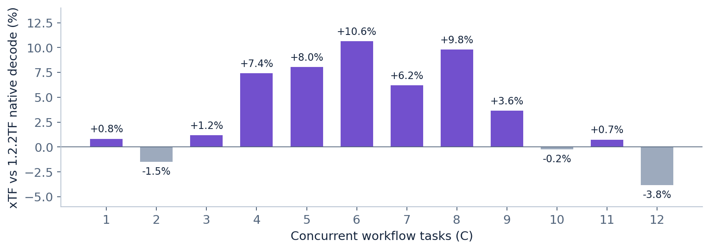
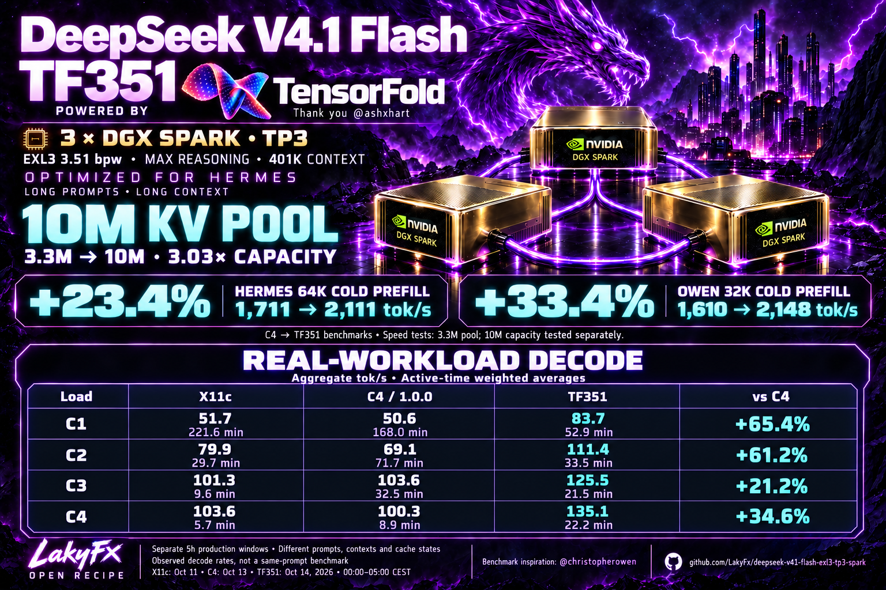

# DeepSeek V4.1 Flash EXL3 on three DGX Sparks

**Current release: [1.2.3](docs/DS41F-1.2.3.md)** — the configuration tested as
**1.2.2xTF**, now with the public adaptive source/build recipe and complete
workflow results. DeepSeek 1017 / EXL3 ~3.51 bpw routed experts / TensorFold TP3:
**C12, R48, 7M configured KV pool, 3 GiB prompt-state cache, MAX reasoning**.
Vision stays **C2 / MEDIUM**, with additional accepted jobs queued.

The speculative controller learns verification cost and draft acceptance
online, then chooses a useful shared row budget. It does not train model
weights or replace the target verifier. We were inspired by
[**AdaSpark — Liu, Zhang and Xu**](https://arxiv.org/abs/2610.05774);
ours is an adaptation in existing TensorFold chain/copy lanes, not a full
AdaSpark/imparo reproduction. [Design, equations and source](docs/ADAPTIVE-SPECULATION.md).

## The main measured results

One matched-initial-input pass, C1–C12, 78 complete tool-using workflows per
recipe. Output includes reasoning. The release rename did not rerun a test.

| Measurement | 1.2.2TF | Bert1 | xTF / 1.2.3 |
|---|---:|---:|---:|
| Correctly completed tasks | 78/78 | 78/78 | 78/78 |
| Sum of measured wave times | 22:27.872 | 23:38.938 | **20:29.795** |
| Median / P95 task duration, s | 117.05 / 170.94 | 118.05 / 182.52 | **108.73 / 154.03** |
| Intermediate rejected tool attempts | 30 | 31 | **16** |
| Pooled draft acceptance | 79.13% | 77.52% | **83.32%** |
| C6 median native decode, tok/s per request | 23.34 | 24.12 | **25.82** |
| C12 median native decode, tok/s per request | **14.65** | 14.36 | 14.09 |

xTF used **8.76% less summed wave time than TF**, with **6.69% fewer generated
tokens**. This is an observed recipe-level gain, not an isolated learner or
model-quality result. All final tasks passed; rejected tools were repaired
inside their measured times. No vision throughput or full 7M capacity test is
claimed. [All 36 cells, latencies, errors, counterexamples and limitations](docs/WORKFLOW-BENCHMARK-20261020.md).



## Use or inspect 1.2.3

- **[Install/build and exact settings](docs/DS41F-1.2.3.md)** · [launcher profile](tensorfold/profiles/1.2.3.json)
- **[Complete benchmark report in Markdown](docs/WORKFLOW-BENCHMARK-20261020.md)** · [PDF](results/20261020-adaptive/workflow-report.pdf) · [all numeric data](results/20261020-adaptive/)
- **[How the online learner works](docs/ADAPTIVE-SPECULATION.md)** · [verified native patch](tensorfold/adaptive/)
- **[Production gateway](docs/GATEWAY.md)** · [pinned 1017 weights](https://huggingface.co/LakyFx/DeepSeek-V4.1-Flash-1017-EXL3-3.5bpw-TensorFold)
- [Historical engine recipes and measurements](#earlier-releases-and-measurements) · [all sources and credits](docs/SOURCES.md)

Thanks to **[Ashley Hart and TensorFold contributors](https://github.com/ashhart/TensorFold)**
for the native engine, **[Christopher Owen](https://github.com/christopherowen/spark-ds41f)**
for recipes, networking and earlier benchmark work, and **[AdaSpark's authors](https://arxiv.org/abs/2610.05774)**
for the online-adaptation inspiration. The model, quantization and upstream
kernels retain their own authorship and licenses.

## Earlier releases and measurements

<details>
<summary>Expand the preserved pre-1.2.3 overview, engine choices and historical benchmark tables</summary>

The material below retains its original dates, checkpoints and measurement
scopes. Statements such as “no comparative benchmark was rerun for 1017”
describe the earlier release at that date, not the new 20 October comparison.


**Production release 1.2.2TF:** the optional [gateway package](docs/GATEWAY.md)
now includes the same Chat/Responses engine, policy defaults and durable vision
jobs as our deployment, with **two image requests processed concurrently** and
all additional accepted jobs queued. Accepted image work survives client disconnection;
retries share a job and only a validated final answer is returned. The package
requires your own API secret, backend URL and private state directory. Model
weights, engine profiles and historical benchmark results retain their scope.

[](https://huggingface.co/LakyFx/DeepSeek-V4.1-Flash-1017-EXL3-3.5bpw-TensorFold)

**New model revision: [DS41F 1.2.0 / DeepSeek 1017](docs/DS41F-1.2.0.md).** This adds our [EXL3 3.5bpw TensorFold weights on Hugging Face](https://huggingface.co/LakyFx/DeepSeek-V4.1-Flash-1017-EXL3-3.5bpw-TensorFold) and the `--variant 1.2.0` launcher profile: TP3, MAX, 401,408 context, 8M configured KV pool, 2 GiB prompt-state cache, S12/R32. The native engine is retained. **All previous variants and test results remain below; no comparative benchmark was rerun for 1017.** [Exact revision, download and launch instructions](docs/DS41F-1.2.0.md).

**A huge thank you to [Ashley Hart, @ashxhart](https://x.com/ashxhart), creator of [TensorFold](https://github.com/ashhart/TensorFold). Its native engine made our TF351 and TF29 TP3 recipes possible. Visit [tensorfold.dev](https://tensorfold.dev/).**

**A big thank you to [Christopher Owen](https://github.com/christopherowen), [@christopherowen on X](https://x.com/christopherowen), for his [spark-ds41f recipes](https://github.com/christopherowen/spark-ds41f), networking work and benchmark. The Owen code/prose benchmark below is explicitly adapted from his GitHub project.**

**Measurement correction, 14 October:** the audited Owen code/prose decode cells generated only the first 256 MAX-reasoning tokens, with no final answer. Their timing is valid, but they are not completed-code/prose rates. The main comparison below now uses **completed Hermes C1/C3 workflows and verified cold prefill against the fresh C4 / 1.0.0 reference**. No model tests were rerun. [Audit, exact scopes and all retained results](docs/BENCHMARK-CORRECTION-20261014.md).



**Production update, 14 October:** the TF351 recipe includes the deployed fix for missing short-prefill `_hc_mix_pf` kernels. Six real SM121 cubins and their AOT entries are added; the expanded checker and CPU/GPU/warm-cache receipts are included. Weights and the **10M shared KV pool** stay unchanged. [Root cause, reproduction and recorded acceptance](docs/TENSORFOLD-HC-PREFILL-FIX.md).

### Real workload: Hermes Agent in production

Observed **aggregate decode tok/s**, weighted by active decode time. Parentheses show active sample minutes. Each version has its own five-hour production window; prompts, contexts and cache warmth differ. These observations supplement the controlled benchmarks below.

| Concurrency | X11c tok/s (min) | C4 / 1.0.0 tok/s (min) | TF351 tok/s (min) | TF351 vs C4 |
|---|---:|---:|---:|---:|
| C1 | 51.7 (221.6) | 50.6 (168.0) | **83.7 (52.9)** | **+65.4%** |
| C2 | 79.9 (29.7) | 69.1 (71.7) | **111.4 (33.5)** | **+61.2%** |
| C3 | 101.3 (9.6) | 103.6 (32.5) | **125.5 (21.5)** | **+21.2%** |
| C4 | 103.6 (5.7) | 100.3 (8.9) | **135.1 (22.2)** | **+34.6%** |
| C5 | 112.1 (3.0) | not observed | 142.0 (24.2) | — |
| C6 | not observed | not observed | 145.7 (12.8) | — |
| C7 | not observed | not observed | 145.6 (8.7) | — |
| C8 | not observed | not observed | **150.6 (75.5)** | — |

**This is not a matched-prompt A/B test or a completed-job rate.** The windows are 00:00–05:00 CEST on 11 October (X11c), 13 October (C4) and 14 October (TF351 / 10M). vLLM uses streaming token-counter deltas; TF integrates native live decode rates. Idle/prefill/stalled periods do not become zero-rate decode samples. The TF window precedes the short-prefill repair, so these are not new post-fix speed results. No production TF29 window is available. [Method, full saved data and limitations](docs/HERMES-REAL-WORKLOAD.md) · [Offline recalculation](tools/audit_real_workload.py).

## Choose an engine and recipe

**The new 1.2.0 / 1017 recipe is additive; the two earlier TensorFold recipes and complete C4/X11c tuning history are preserved.** The preceding selected TensorFold profile was **TF351: TP3, approximately 3.51 bpw routed experts, MAX reasoning, 401K context and a separately stress-qualified 10M shared KV pool**. TF29 is the earlier faster-decode 2.9 bpw alternative; its tested pool is 3.3M. The historical tables on this page retain those older checkpoints and settings.

| Version | Engine / routed experts | Shared KV pool | Recipe and complete tests |
|---|---|---:|---|
| **1.2.0 / 1017** | **TensorFold / new DeepSeek 1017 EXL3 ~3.51 bpw** | **8M configured** | [New recipe and pinned HF weights](docs/DS41F-1.2.0.md); recorded functional smoke only, no new comparative benchmark |
| X11c / B0 | vLLM / Pollard ~3.51 bpw | ~3.3M | [Historical baseline](docs/VARIANTS.md#b0), [all 18 host64k arms](docs/CAMPAIGN-20261012.md) |
| C4 / DS41F 1.0.0 | vLLM / Pollard ~3.51 bpw | 3,299,563 observed | [Retained C4 recipe](docs/DS41F-1.0.0.md), [fresh TF comparison reference](docs/TENSORFOLD-RESULTS.md#c4-reference) |
| **TF351** | **TensorFold / Pollard ~3.51 bpw** | **10M qualified; 3.3M speed profile** | [Recipe](docs/TF351.md), [source/build/install](docs/TENSORFOLD-INSTALL.md), [tests](docs/TENSORFOLD-RESULTS.md#tf351) |
| TF29 | TensorFold / Mia 2.9 bpw | 3.3M qualified | [Recipe](docs/TF29.md), [tests](docs/TENSORFOLD-RESULTS.md#tf29) |

### Hermes: completed agent work and verified cold prefill

**C3 was tested:** one code task, one tool/accounting task and one evidence-analysis task submitted together, with correctness checks and tool rounds. Each workflow starts with approximately 8K input tokens; the separate long-context probes use 64K and three 128K inputs. The final native workflows use repaired V7 history; cold/hot load probes below retain their separately labelled full V3 measurements. C4 is the fresh frozen reference from that comparison, not the older X11c campaign.

| Measurement / stage | C4 / 1.0.0 reference | TF351 | TF29 | TF351 vs C4 |
|---|---:|---:|---:|---:|
| Completed workflow C1 wall, seconds; final | 22.97 | **15.21** | 22.28 | **33.8% less time** |
| Completed workflow C3 cohort wall, seconds; final | 39.00 | **35.60** | 43.67 | **8.7% less time** |
| Workflow C1 request decode, tok/s; final | 62.32 | **85.00** | 88.90 | +36.4% |
| Workflow C3 request decode, tok/s; final | 31.83 | **34.49** | 41.81 | +8.4% |
| Hermes 64K-C1 cold computed prefill, tok/s; V3 | 1,710.85 | **2,111.26** | 2,118.82 | **+23.4%** |
| Hermes 128K-C3 cold computed prefill, tok/s; V3 | 1,638.88 | **2,040.97** | 2,056.49 | +24.5% |
| Hermes 8K-C8 hot bounded probe, aggregate output/wall tok/s; V3 | 150.59 | **199.25** | 221.02 | +32.3% |
| Owen nominal 32K cold input/TTFT, tok/s; C4 V3 / TF final V7 | 1,610.05 | **2,147.64** | 2,161.99 | +33.4% |
| Owen nominal 256K cold input/TTFT, tok/s; V3 | 1,680.63 | **1,976.48** | 1,989.41 | +17.6% |

Workflow decode counts **reasoning, tool output and final output** over summed per-request engine decode time. It is not aggregate C3 throughput or a visible-answer-only rate. Workflow wall measures completed tasks; output lengths differ: C4/TF351/TF29 emit **1,003/877/1,559** tokens at C1 and **2,185/2,616/3,621** at C3. All four final workflows pass in each arm. TF29's higher token rate did **not** make its C3 tasks finish faster. C8 is a short hot throughput probe, not eight scored workflows.

Hermes prefill counts verified uncached input over each engine's prefill timer; Owen counts actual input over HTTP TTFT. These are separate metrics. Hermes has one pass per arm; Owen V3 cold has two repeats and final V7 cold has one. **Speed tests used a 3.3M pool; TF351's 10M capacity passed a separate stress test.** [Recalculate these values offline from published receipts](tools/audit_tensorfold_results.py), [machine-readable audit](results/20261013-tensorfold/comparison-audit.json).

<!-- tf-complete-saved:start -->
### Complete saved TensorFold comparison: every measured load regime

All tables here use the **fresh C4 reference and the full V3 native captures**, unless a row explicitly says final V7 above. No missing cell is reconstructed. These are the seven coverage20 phases plus the separately attributed Owen subset; the original full16 legacy option was not run. [Every retained receipt and hash](results/20261013-tensorfold/evidence-manifest.json).

**Full V3 Owen short reasoning-only decode: three measured repeats after warmup.** Code/prose identify prompts; all measured outputs stop at 256 reasoning tokens with no final answer. These are not completed-answer rates.

| Version | Code-prompt C1 | C2 | C4 | C8 total | Prose-prompt C1 | C2 | C4 | C8 total |
|---|---:|---:|---:|---:|---:|---:|---:|---:|
| C4-reference | 53.51 | 85.18 | 128.43 | 208.62 | 37.42 | 64.63 | 99.80 | 152.51 |
| TF351 | 84.40 | 161.45 | 255.80 | 392.87 | 83.13 | 159.71 | 259.21 | 393.33 |
| TF29 | 93.15 | 181.12 | 306.40 | 413.59 | 86.41 | 162.90 | 242.64 | 405.61 |

Final V7 C1/C8 below are a separate one-wave subset, not an average blended with these three repeats. Owen has no C3 cell. The retained cold 32K/256K values and stages are in the main table above.

**Hermes legacy six-cell screen: C3 cold and C1/C3 hot, code and prose.** Same frozen legacy inputs, MAX, cap256, temperature0, one measurement per cell, verified cold/hot cache. These are bounded throughput probes. Request decode and cohort wall rates have different denominators.

| Phase / prompt / concurrency | C4 request decode | TF351 request decode | TF29 request decode | C4 cohort output/wall | TF351 cohort output/wall | TF29 cohort output/wall |
|---|---:|---:|---:|---:|---:|---:|
| cold / code / C3 | 13.74 | 19.46 | 20.47 | 17.18 | 24.80 | 25.10 |
| cold / prose / C3 | 12.20 | 17.16 | 17.75 | 14.89 | 21.42 | 21.73 |
| hot / code / C1 | 69.12 | 98.33 | 136.51 | 62.85 | 96.82 | 133.62 |
| hot / prose / C1 | 53.26 | 93.85 | 97.41 | 49.14 | 92.38 | 95.36 |
| hot / code / C3 | 38.61 | 59.43 | 68.66 | 91.02 | 162.81 | 175.28 |
| hot / prose / C3 | 33.72 | 56.44 | 62.70 | 85.72 | 158.76 | 176.80 |

All rates are tok/s and include reasoning. Cold C3 request decode can include interleaved prefill stalls. The six cells are the actual screen; unrun cold C1/C2/C4 and hot C2/C4 cells are not filled in.

**Long-context and short-C8 cold/hot load probes, V3.** Cold input counts match across arms. Hot requests have 128 output tokens at 64K/128K and 256 at 8K; these are not scored finished tasks. Cold wall is reported separately from summed engine prefill time.

| Measurement | C4 reference | TF351 | TF29 |
|---|---:|---:|---:|
| 64K-C1 cold computed prefill tok/s | 1710.85 | 2111.26 | 2118.82 |
| 64K-C1 hot cohort wall seconds | 2.93 | 1.50 | 1.39 |
| 64K-C1 hot aggregate output/wall tok/s | 43.72 | 85.39 | 92.21 |
| 64K-C1 cold prime cohort wall seconds | 38.42 | 31.12 | 31.01 |
| 64K-C1 hot prefix hit | 99.81% | 100.00% | 100.00% |
| 128K-C3 cold computed prefill tok/s | 1638.88 | 2040.97 | 2056.49 |
| 128K-C3 hot cohort wall seconds | 5.15 | 3.00 | 2.68 |
| 128K-C3 hot aggregate output/wall tok/s | 74.53 | 127.80 | 143.16 |
| 128K-C3 cold prime cohort wall seconds | 230.24 | 192.80 | 191.36 |
| 128K-C3 hot prefix hit | 99.92% | 100.00% | 100.00% |
| 8K-C8 cold computed prefill tok/s | 877.68 | 1993.76 | 2007.10 |
| 8K-C8 hot cohort wall seconds | 13.60 | 10.28 | 9.27 |
| 8K-C8 hot aggregate output/wall tok/s | 150.59 | 199.25 | 221.02 |
| 8K-C8 cold prime cohort wall seconds | 39.57 | 32.83 | 32.61 |
| 8K-C8 hot prefix hit | 98.60% | 100.00% | 100.00% |

**Mixed probe, V3:** three hot leaders and one verified cold 32K arrival, injected after a real streamed delta. All four owned requests completed; priming is separate from leader wall throughput. This phase is a bounded load test, not scored workflow completion.

| Mixed measurement | C4 reference | TF351 | TF29 |
|---|---:|---:|---:|
| Phase wall, seconds | 52.55 | 37.35 | 35.31 |
| Leader aggregate output/wall, tok/s | 58.46 | 82.25 | 87.00 |
| Cold arrival TTFT, seconds | 21.30 | 15.51 | 15.45 |
| Cold arrival wall, seconds | 25.89 | 18.68 | 17.90 |
| All-phase weighted request decode, tok/s | 20.41 | 28.43 | 29.90 |

**Earlier V3 workflow failures remain visible.** TF29 finished only two of the four scored tasks; it requested an unknown fixture path. Its short failed-task times are not speed wins. Final V7 repaired history and completed 4/4.

| Full V3 workflow measurement | C4 reference | TF351 | TF29 |
|---|---:|---:|---:|
| C1 workflow wall, seconds | 22.97 | 16.26 | 11.03 (failed task) |
| C3 cohort wall, seconds | 39.00 | 37.25 | 35.52 (failed task) |
| Correct completed workflows | 4/4 | 4/4 | 2/4; final V7: 4/4 |

The separately retained initial pre-repair campaign had incomplete native cache qualification and is **not** a whole-suite speed comparison. Its38-attempt strict quality scores were 26/38, 24/38 and 30/38 for C4/TF351/TF29; the later bounded Q20 screen is a different suite. [Initial speed tables, all strict regressions and failures](docs/TENSORFOLD-RESULTS.md#initial-full-comparison-before-cache-repairs). [Per-attempt Q20 outcomes](docs/TENSORFOLD-RESULTS.md#bounded-q20-quality-screen) and the three original quality seeds are retained. The corrected results do not turn failures into passes.

<details>
<summary>Initial pre-repair native matrix and strict quality scores (historical failures retained)</summary>

This is the initial v22 capture, source `178f28a`, before V3/V7 cache/history repairs. The native Hermes suite was incomplete, so its total wall time is not a speed win. These are saved short decode probes; they are not completed-code/prose task rates. The C4 reference is reused, not newly measured at each repair.

| Initial Owen short decode / prefill metric | C4 | TF351 initial | TF29 initial |
|---|---:|---:|---:|
| Code-prompt C1 / C2 / C4 / C8 | 53.51 / 85.18 / 128.43 / 208.62 | 83.55 / 149.43 / 216.90 / 297.04 | 93.28 / 166.76 / 253.91 / 310.91 |
| Prose-prompt C1 / C2 / C4 / C8 | 37.42 / 64.63 / 99.80 / 152.51 | 82.30 / 147.28 / 219.27 / 299.36 | 85.22 / 150.46 / 208.54 / 308.40 |
| Cold 32K / cold 256K input/TTFT | 1,610.05 / 1,680.63 | 2,145.69 / 1,978.39 | 2,162.50 / 1,991.50 |
| Original strict greedy quality | 18/26 | 16/26 | 20/26 |
| Original strict sampled quality, seed 2026 | 4/6 | 4/6 | 5/6 |
| Original strict sampled quality, seed 1708 | 4/6 | 4/6 | 5/6 |
| Total original strict attempts passed | 26/38 | 24/38 | 30/38 |
| Actual code sandbox tasks passed | 5/6 | 5/6 | 5/6 |

Those original native comparator gates were TF351 **REGRESSION** and TF29 **INCOMPLETE**, not unconditional quality passes. Hidden formatting/locale expectations and output truncation are documented; the original outcomes were not retrospectively regraded. The later Q20 is a separately frozen suite. [Original attempts, anonymous grades and sandbox evidence](results/20261013-tensorfold/evidence/initial-v22), [diagnosis and limitations](docs/TENSORFOLD-RESULTS.md#initial-full-comparison-before-cache-repairs).

</details>

<!-- tf-complete-saved:end -->

### Owen short MAX-reasoning decode microbenchmark

**Code/prose describe the input prompt. All 270 measured full V3 requests and 36 final V7 requests exhausted the 256-token cap in reasoning, with zero final-content characters. These figures are not rates for completed code or prose.** The original numbers remain visible, with their actual interpretation.

| Version / measurement stage | Code-prompt C1 | Code-prompt C8 total | Prose-prompt C1 | Prose-prompt C8 total | Owen cold 32K | Owen cold 256K |
|---|---:|---:|---:|---:|---:|---:|
| X11c: historical B0 | 59.8 | 192.9 | 40.9 | 153.3 | 1,254.1 | 1,230.2 |
| C4: fresh reference, V3 | 53.51 | 208.62 | 37.42 | 152.51 | 1,610.1 | 1,680.6 |
| **TF351: final V7 subset** | **84.47** | **396.03** | **83.51** | **394.95** | **2,147.6** | not rerun; V3: **1,976.5** |
| TF29: final V7 subset | 93.33 | 416.23 | 86.96 | 408.81 | 2,162.0 | not rerun; V3: 1,989.4 |

All speeds are **tok/s**. Owen C8 is aggregate reasoning decode-window throughput, not per-stream speed; TF351's 396.03 total is about 49.5 per stream. Cold prefill is actual input tokens / HTTP TTFT. C4 and historical X11c decode use three measured repeats; final V7 uses one measured wave after warmup. The full V3 matrix has three repeats at C1/C2/C4/C8 for both TF arms. X11c is an earlier campaign, not a fresh paired TF baseline. The audit above directly checks the C4/TF V3 and final V7 cells.

### Hermes agent work, cache and bounded quality

| Measurement | C4 reference | TF351 | TF29 |
|---|---:|---:|---:|
| Final workflow C1 wall time, lower is better | 22.97 s | **15.21 s** | 22.28 s |
| Final workflow C3 cohort wall time, lower is better | 39.00 s | **35.60 s** | 43.67 s |
| Newly computed workflow input, C1 / C3 | 8,667 / 25,807 | **8,352 / 25,249** | **8,352 / 25,249** |
| Correct completed workflows | 4/4 | 4/4 final | 4/4 final; 2/4 in earlier V3 |
| Identical-prefix hot cache, 64K-C1 / 128K-C3 / 8K-C8 | 99.81% / 99.92% / 98.60% | 100% / 100% / 100% V3 | 100% / 100% / 100% V3 |
| Q20 bounded quality screen | 20/24 | 20/24 | 21/24 |
| Six HumanEvalPlus-derived code tasks | 5/6 | 5/6 | 5/6 |

The independently derived **Hermes 64K cold prefill for TF351 was 2,111.3 tok/s**, versus fresh C4 **1,710.9, +23.4%**. It counts 65,534 verified uncached input tokens over 31.0403 s engine prefill time. The older X11c result was 1,318.0; its +60.2% difference is a historical cross-campaign comparison, not the C4 gain. TF351 and TF29 compute exactly the same final workflow input counts despite different output lengths and cache percentages.

**[Full results, every repeat, failures and quality cases](docs/TENSORFOLD-RESULTS.md)** · **[Run Hermes, Owen and Q20](docs/TENSORFOLD-BENCHMARK.md)** · **[8,265 numerical receipts and hashes](results/20261013-tensorfold/evidence-manifest.json)**

The tiny Q20 quality screen is a regression check, not a leaderboard or proof that 2.9 bpw is better. The [initial 38-attempt quality comparison and its strict regressions](docs/TENSORFOLD-RESULTS.md#initial-full-comparison-before-cache-repairs) are also preserved; they are a different suite and are not overwritten by Q20. TF changes ancillary weights, KV/index precision, sampler and engine in addition to routed-expert bits. Historical strict partial-prefix numerical mismatches and incomplete tests are retained. [Read verification limits](docs/TENSORFOLD-TP3.md#results-and-verification-scope).

The model, quantization, engines and upstream kernels are other people's work. Our contribution is integration, TP3 adaptation, cache fixes, bounded correctness checks and workload measurements. All earlier [sources and credits](docs/SOURCES.md) remain.

## Start here

- **TensorFold:** [overview](docs/TENSORFOLD-TP3.md), [TF351](docs/TF351.md), [TF29](docs/TF29.md), [installation](docs/TENSORFOLD-INSTALL.md), [results](docs/TENSORFOLD-RESULTS.md), [benchmark reproduction](docs/TENSORFOLD-BENCHMARK.md).
- **Preserved vLLM C4:** [1.0.0 recipe](docs/DS41F-1.0.0.md), [installation](docs/INSTALL.md), [host environment](docs/HOST-ENVIRONMENT.md), [verification](docs/VERIFICATION.md), [architecture](docs/ARCHITECTURE.md).
- **All historical versions:** [18-arm campaign](docs/CAMPAIGN-20261012.md), [variant picker](docs/VARIANTS.md), [earlier A/B/X history](docs/HISTORY.md), [materialize other vLLM recipes](docs/EXPERIMENT-REPLAY.md).
- **Credits and workload sources:** [SOURCES.md](docs/SOURCES.md), [Owen attribution](docs/OWEN-BENCHMARK.md), [legacy Hermes methodology](docs/BENCHMARKS.md).

Agents should read [AGENTS.md](AGENTS.md). Topology is operator-owned; private addresses, secrets, conversations and generated private answers are excluded.

<!-- variant-catalog:start -->
## Preserved vLLM campaign: choose your variant

**18 measured recipes. Same EXL3 weights. Different workload tradeoffs.**

| Your priority | Start by comparing | Why |
|---|---|---|
| Long-context agent work | **C4 / DS41F 1.0.0**, N6 | The only two arms to finish the full bounded 128K-C3 cold/hot phase |
| Hermes single-request decode | C3, C5-indexer | Highest and second-highest measured Hermes C1 |
| Hermes eight-request throughput | C5-indexer, N8b, B0 | Highest measured Hermes C8 wall throughput |
| Short code-prompt decode at eight requests | N3, N1, N4 | Highest measured Owen code-prompt C8 decode-window throughput; capped reasoning probes |
| Reference comparison | B0 | Fresh X11c baseline on the same upgraded hosts |

These are candidates to evaluate, not universal winners. **C4 was the selected vLLM production recipe; the other vLLM arms remain experimental alternatives. TensorFold profiles above are separate recipes.**
Click any variant below for its changes, tradeoffs, build commands and verification scope.
[All variant recipes](docs/VARIANTS.md) · [Reproduction guide](docs/EXPERIMENT-REPLAY.md) · [Verification status](docs/VARIANT-VALIDATION.md)

### Hermes: our agent workload

All values are **tok/s**. C1/C3 are weighted **per-request engine decode**; C8 is **aggregate output / cohort wall time**, including first-token latency. Prefill counts newly computed tokens over native prefill time. This is not one concurrency scaling curve.

| Variant | C1 decode | C3 decode | C8 wall | 64K prefill | 128K prefill |
|---|---:|---:|---:|---:|---:|
| [B0](docs/VARIANTS.md#b0) | 62.3 | 31.2 | 159.0 | 1,318.0 | n/a |
| [N1](docs/VARIANTS.md#n1) | 58.5 | 29.7 | 156.0 | 1,283.4 | 1,209.8* |
| [N2](docs/VARIANTS.md#n2) | 62.1 | 31.9 | 158.5 | 1,405.0 | 1,291.3* |
| [N3](docs/VARIANTS.md#n3) | 55.1 | 32.7 | 151.2 | 1,284.8 | n/a |
| [N4](docs/VARIANTS.md#n4) | 63.5 | 32.7 | 150.7 | 1,400.2 | 1,242.8* |
| [N5](docs/VARIANTS.md#n5) | 65.4 | 33.0 | 154.6 | 1,337.4 | 1,264.8* |
| [N6](docs/VARIANTS.md#n6) | 59.4 | 31.1 | 145.7 | **1,770.3** | **1,694.4** |
| [N7a](docs/VARIANTS.md#n7a) | 65.3 | 33.1 | 149.8 | 1,286.6 | n/a |
| [N7b](docs/VARIANTS.md#n7b) | 63.9 | 29.7 | 155.2 | 1,285.7 | n/a |
| [N8a](docs/VARIANTS.md#n8a) | 65.9 | 28.9 | 157.0 | 1,280.0 | n/a |
| [N8b](docs/VARIANTS.md#n8b) | 60.6 | 30.5 | 159.6 | 1,351.1 | 1,226.3* |
| [C1](docs/VARIANTS.md#c1) | 59.2 | 33.1 | 148.6 | 1,400.0 | 1,292.0* |
| [C2](docs/VARIANTS.md#c2) | 61.0 | 30.9 | 155.9 | 1,342.1 | 1,186.0* |
| [C3](docs/VARIANTS.md#c3) | **68.1** | 31.3 | 149.1 | 1,279.6 | n/a |
| [C4 / 1.0.0](docs/VARIANTS.md#c4) | 63.6 | 34.1 | 146.1 | 1,734.1 | 1,643.7 |
| [C5-indexer](docs/VARIANTS.md#c5-indexer) | 66.7 | 29.8 | **162.1** | 1,284.9 | n/a |
| [C5-sp512](docs/VARIANTS.md#c5-sp512) | 60.7 | 31.5 | 153.8 | 1,402.8 | 1,282.4* |
| [C5-sp256](docs/VARIANTS.md#c5-sp256) | 65.4 | **34.3** | 158.9 | 1,347.6 | 1,211.3* |

`*` Cold prime measured, but the full 128K-C3 phase did not finish. `n/a` is missing, not zero. Only N6 and C4 completed that full phase.

### Christopher Owen benchmark: code-prompt short decode

Adapted from [Christopher Owen's spark-ds41f](https://github.com/christopherowen/spark-ds41f), with [frozen source, inputs and methodology](docs/OWEN-BENCHMARK.md). Values are aggregate **decode-window tok/s**, averaged over three measured repeats after a discarded warmup. The 256-token MAX probes can stop inside reasoning; they do not require a completed code answer. See the [audited TensorFold comparison limitation](docs/BENCHMARK-CORRECTION-20261014.md).

| Variant | C1 | C2 | C4 | C8 |
|---|---:|---:|---:|---:|
| [B0](docs/VARIANTS.md#b0) | **59.8** | 84.9 | 127.3 | 192.9 |
| [N1](docs/VARIANTS.md#n1) | 55.7 | 85.6 | 132.9 | 205.6 |
| [N2](docs/VARIANTS.md#n2) | 56.9 | **90.3** | 132.8 | 196.5 |
| [N3](docs/VARIANTS.md#n3) | 57.5 | 83.5 | 131.2 | **208.5** |
| [N4](docs/VARIANTS.md#n4) | 55.5 | 85.2 | 119.7 | 204.2 |
| [N5](docs/VARIANTS.md#n5) | 58.5 | 82.0 | 130.6 | 191.0 |
| [N6](docs/VARIANTS.md#n6) | 56.8 | 84.5 | 130.4 | 187.8 |
| [N7a](docs/VARIANTS.md#n7a) | 56.8 | 81.8 | 128.4 | 196.7 |
| [N7b](docs/VARIANTS.md#n7b) | 58.9 | 87.3 | 128.3 | 201.2 |
| [N8a](docs/VARIANTS.md#n8a) | 56.9 | 79.8 | 130.4 | 195.1 |
| [N8b](docs/VARIANTS.md#n8b) | 57.9 | 84.2 | 127.8 | 192.8 |
| [C1](docs/VARIANTS.md#c1) | 56.0 | 84.7 | 126.9 | 202.1 |
| [C2](docs/VARIANTS.md#c2) | 56.7 | 82.3 | 129.0 | 195.9 |
| [C3](docs/VARIANTS.md#c3) | 56.3 | 78.0 | 128.0 | 190.9 |
| [C4 / 1.0.0](docs/VARIANTS.md#c4) | 57.3 | 83.7 | 129.0 | 194.5 |
| [C5-indexer](docs/VARIANTS.md#c5-indexer) | 56.8 | 78.5 | 127.2 | 194.0 |
| [C5-sp512](docs/VARIANTS.md#c5-sp512) | 57.2 | 82.9 | 131.1 | 198.6 |
| [C5-sp256](docs/VARIANTS.md#c5-sp256) | 55.9 | 86.3 | **133.4** | 201.3 |

### Christopher Owen benchmark: prose-prompt short decode and cold prefill

Prose uses the same decode-window metric. Prefill is **input tokens / TTFT**, including first-token overhead; it differs from the Hermes native computed-prefill metric.

| Variant | Prose C1 | Prose C2 | Prose C4 | Prose C8 | 32K prefill | 256K prefill |
|---|---:|---:|---:|---:|---:|---:|
| [B0](docs/VARIANTS.md#b0) | 40.9 | 65.2 | 97.9 | 153.3 | 1,254.1 | 1,230.2 |
| [N1](docs/VARIANTS.md#n1) | 43.3 | 64.3 | 97.3 | 150.7 | 1,188.0 | 1,237.4 |
| [N2](docs/VARIANTS.md#n2) | 40.8 | 65.8 | 96.8 | **156.3** | 1,202.8 | 1,270.3 |
| [N3](docs/VARIANTS.md#n3) | 40.9 | 66.8 | 94.3 | 150.1 | 1,116.0 | 1,215.4 |
| [N4](docs/VARIANTS.md#n4) | 39.4 | 63.9 | 99.5 | 149.6 | 1,255.6 | 1,223.0 |
| [N5](docs/VARIANTS.md#n5) | 40.4 | 63.1 | **103.6** | 149.1 | 1,196.4 | 1,252.1 |
| [N6](docs/VARIANTS.md#n6) | **45.2** | 65.4 | 97.9 | 154.7 | **1,629.7** | 1,593.7 |
| [N7a](docs/VARIANTS.md#n7a) | 39.1 | 66.3 | 94.2 | 151.7 | 1,238.9 | 1,212.5 |
| [N7b](docs/VARIANTS.md#n7b) | 44.2 | **67.6** | 98.1 | 154.4 | 1,176.8 | 1,221.9 |
| [N8a](docs/VARIANTS.md#n8a) | 38.3 | 64.3 | 98.1 | 150.0 | 1,183.7 | 1,232.9 |
| [N8b](docs/VARIANTS.md#n8b) | 39.8 | 66.9 | 98.2 | 153.4 | 1,257.3 | 1,256.1 |
| [C1](docs/VARIANTS.md#c1) | 42.0 | 63.6 | 97.3 | 151.3 | 1,259.5 | 1,242.4 |
| [C2](docs/VARIANTS.md#c2) | 41.3 | 61.9 | 96.0 | 150.9 | 1,249.7 | 1,251.2 |
| [C3](docs/VARIANTS.md#c3) | 40.9 | 64.1 | 96.6 | 150.8 | 1,176.9 | 1,196.6 |
| [C4 / 1.0.0](docs/VARIANTS.md#c4) | 41.3 | 64.6 | 99.8 | 150.3 | 1,619.9 | **1,687.2** |
| [C5-indexer](docs/VARIANTS.md#c5-indexer) | 38.2 | 64.0 | 101.8 | 150.7 | 1,238.0 | 1,208.5 |
| [C5-sp512](docs/VARIANTS.md#c5-sp512) | 37.7 | 66.1 | 97.3 | 151.3 | 1,205.0 | 1,222.9 |
| [C5-sp256](docs/VARIANTS.md#c5-sp256) | 38.7 | 62.7 | 102.5 | 150.9 | 1,200.6 | 1,266.4 |

**Reading these tables:** bold marks the largest observed value in a column, not a statistically established winner. Hermes has one campaign pass per arm; Owen decode has three repeats. MAX reasoning was used for chat requests. Candidate names C1/C3/C4 are not concurrency levels. Results depend on prompt, acceptance, context and cache state. See [complete campaign limitations](docs/CAMPAIGN-20261012.md#completeness-correctness-and-interpretation).

### Reproduce a choice

Clone the current repository with tags, select an arm and build on Linux ARM64. For example:

```bash
git fetch origin --tags
python3 experiments/materialize.py --arm C5-indexer --output /srv/dsv41-build-c5-indexer
cd /srv/dsv41-build-c5-indexer
RECIPE_IMAGE=ds41f:experiment-c5-indexer bash build/build.sh
cp config/cluster.example.json config/cluster.local.json
```

Fill in your topology and paths, then follow [installation](docs/INSTALL.md#3-download-and-prepare-the-checkpoint) and [acceptance checks](docs/VERIFICATION.md#operator-acceptance). The commands above prepare/build only; they do not deploy. Source reconstruction is checked separately from public image builds and GPU qualification. Historical measurements do not certify a new image.

<!-- variant-catalog:end -->

## Preserved C4 / 1.0.0 settings

| Setting | DS41F 1.0.0 / C4 |
|---|---|
| Engine / parallelism | Pinned vLLM + CUDA EXL3, TP3, PP1, EP disabled |
| Checkpoint | [Pollard EXL3 3.5 bpw](https://huggingface.co/bot-lab-21/DeepSeek-V4.1-Flash-EXL3-3.5bpw-Pollard), pinned revision; no weight change during tuning |
| Host | Kernel `7.0.0-1019-nvidia-64k`, 64K pages, driver `580.178.04`, signed memory-saver packing |
| KV | 8,074,035,200 bytes per rank, native `fp8_ds_mla`, 3.30M observed logical tokens |
| Context / scheduler | Maximum 401,408 tokens, eight sequences, 4,096-token prefill chunks |
| Engram | Local disk, 32 readers, native conversion and overlapped reads |
| Draft | DSpark K5, probabilistic draft/block rejection, adaptive verification with eligible C1 full-proposal path |
| Reasoning | Main MAX; vision medium mapped to native `high` |
| C4 additions | N1 + N2 + N3 + N4 + N6 over the qualified X11c host64k baseline |
| Long prefill | Bounded decoder replay with cache, indexer, vision and row-partitioning integration |

The KV pool is shared capacity, not a per-request context limit or a guarantee that eight maximum-length requests always fit. The 3.51 bpw figure describes routed experts, not every tensor in the hybrid checkpoint.

## Measured tradeoff

| Same-campaign metric | B0: X11c host64k | C4: 1.0.0 |
|---|---:|---:|
| Hermes C1 request decode tok/s | 62.3 | 63.6 |
| Hermes C3 request decode tok/s | 31.2 | 34.1 |
| Hermes C8 hot output/wall tok/s | 159.0 | 146.1 |
| Hermes cold 64K computed prefill tok/s | 1,318.0 | **1,734.1** |
| Owen code C8 decode-window tok/s | 192.9 | **194.5** |
| Owen cold nominal 256K input/TTFT tok/s | 1,230.2 | **1,687.2** |

C4 improved the measured long prefill by about 32?37% in these two distinct tests. It was one of only two arms to complete the bounded 128K-C3 cold/hot phase. **It did not win every decode cell:** Hermes C8 declined, while other candidates were stronger there. We chose the long-context compromise for our workload. The original Hermes 70+ C1 and 180+ C8 targets were not both achieved.

These are different metric definitions, not interchangeable speeds. Hermes has one campaign pass per arm; Owen averages three measured decode repeats. We publish output lengths, acceptance, cache evidence and incomplete phases, not confidence intervals or a universal speedup claim.

## Source and evidence

| Path | Contents |
|---|---|
| `config/ds41f-1.0.0.json` | Preserved exact C4 profile; `config/x11c.json` is historical |
| `tensorfold/` | TF351 / TF29 profiles, native source/kernel snapshots, export plans and isolated benchmark kit |
| `runtime/rootfs/`, `native/` | Selected C4 sources and rebuild inputs |
| `runtime/source-provenance.json` | Measured source and portable export hashes |
| `experiments/20261012/` | Baseline and per-arm source/settings archive |
| `benchmarks/` | Public Hermes workloads and frozen Owen common-context adapter |
| `results/` | All retained historical campaigns and current numerical envelopes |
| `licenses/` | Third-party notices |

Private captured legacy prompts and generated private text are excluded. The public legacy surrogates can be measured as a new comparison; they are not identical historical inputs. C4 has historical production qualification; a newly built portable image or native binary still needs acceptance on your cluster. This repository update did not reload the running model.


</details>
