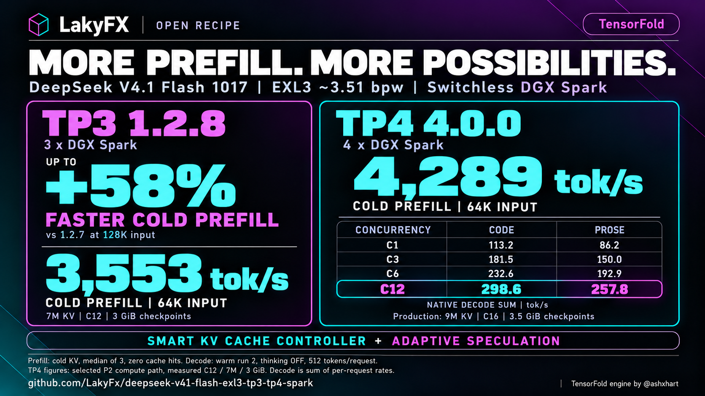

# TP4 4.0.0 - short code and prose decode benchmark

**Up to 298.6 tok/s code and 257.8 tok/s prose at C12**, measured on the
selected native compute path now used by **TP4 4.0.0**. Single-request rates
were **113.2 tok/s code / 86.2 tok/s prose**. These are native decode rates,
with prefill excluded. This is the short diverse-prompt screen, separate
from SparkDash and the heavy agent/tool workflow.

## Warm second-pass results

| Concurrent requests | Code native decode sum, tok/s | Prose native decode sum, tok/s | Code median / request, tok/s | Prose median / request, tok/s |
| --- | ---: | ---: | ---: | ---: |
| C1 | **113.23** | **86.25** | 113.23 | 86.25 |
| C3 | **181.53** | **150.04** | 60.43 | 49.58 |
| C6 | **232.64** | **192.86** | 38.43 | 31.53 |
| C12 | **298.61** | **257.80** | 23.92 | 20.76 |

**Native decode sum** is the sum of the individual requests'
`tensorfold.tokens_per_second` counters. It excludes prefill but is not an
instantaneous cluster peak or a shared first-to-last-token-window aggregate.
The requests can finish at different times. Multiplying the median by
concurrency is also a different calculation.

For comparison, dividing all generated tokens by each complete batch's wall
time gives the following separately scoped values, including preparation,
prefill and any batch tail:

| Concurrent requests | Code whole-wave tok/s | Prose whole-wave tok/s |
| --- | ---: | ---: |
| C1 | 112.80 | 85.95 |
| C3 | 178.34 | 146.13 |
| C6 | 214.81 | 185.50 |
| C12 | 263.73 | 237.12 |

These definitions differ from the preserved stock SparkDash aggregate, so
do not directly rank the 298.61 figure against a SparkDash score.

## Exact measurement scope

| Item | Measured setting |
| --- | --- |
| Date / measured label | 31 October 2026 / selected P2 |
| Hardware | Four NVIDIA DGX Spark / GB10 nodes, switchless TP4 RoCE cycle |
| Model | DeepSeek-V4.1-Flash-1017, source revision `1bae0e1088993b9b82de08f59de5be5a34e42170` |
| Quantization | LakyFx mixed EXL3, ~3.510072157 bpw routed experts; weight revision `8621801c1fc74aece1fa83e67c6ade3fde1e7894` |
| Native code | Same selected head/follower binary hashes as [4.0.0 production parity](../results/20261031-4.0.0/PRODUCTION-PARITY.json) |
| Measured capacity | **C12 / adaptive R48 / 7M physical KV / 3 GiB checkpoints** |
| Current 4.0.0 capacity | **C16 / adaptive R48 / 9M physical KV / 3.5 GiB checkpoints** |
| Compute / KV quantum | 8,192 / 2,048 tokens |
| Benchmark concurrency | C1 / C3 / C6 / C12; no C16 short-screen score |
| Inputs | Twelve authored software topics, independent code/prose prompts |
| Output / sampler | 512 tokens/request, greedy, temperature 0, top_p 1, seed 42, thinking OFF |
| Passes | Two consecutive passes; table uses only pass 2, with no cache/controller reset |
| Coverage | 88 requests / 45,056 generated tokens across both passes |
| Speculative acceptance | **76.07%** accepted/drafted tokens across second-pass cells |

4.0.0 is the final P3 capacity profile, retaining the selected P2 native
compute path. The short-screen data is published under 4.0.0 with that
provenance; it was **not rerun after the capacity increase**. Publication
changes documentation, not production, and performs no new inference.

The first pass warms KV, CUDA/Engram state and the adaptive controller
together. A faster second pass alone does not prove that learning caused
the improvement. Fixed-length generation measures speed; full tool/task
correctness is assessed separately by the [frozen workflow](BENCHMARK-4.0.0.md).

## Cold-prefill and release-poster figures

| Recipe | Cold prefill at 64K, median tok/s | Gain against TP3 1.2.7 at 128K |
| --- | ---: | ---: |
| TP3 1.2.8 / AF | **3,552.8** | **+57.9%** (2,215.8 to 3,499.2 tok/s) |
| TP4 4.0.0 selected P2 compute path | **4,289.3** | Separate four-node configuration |

Three C1 samples per input size, zero KV cache hits. The **"up to +58%"**
poster headline rounds the TP3 128K gain; it is not the gain at the 64K
3,553 tok/s figure. [TP3 prefill methodology](PREFILL-1.2.8.md) and
[TP4 cold-prefill table](BENCHMARK-4.0.0.md#historical-p2-cold-prefill---same-selected-compute-path).

[](../assets/4.0.0/tp3-tp4-release.png)

## Reproduce and independently audit

- [Portable standard-library benchmark and exact public prompts](../benchmarks/short_decode/)
- [All 16 cells from both passes](../results/20261031-4.0.0/SHORT-DECODE.json)
- [All 88 allowlisted request counter records](../results/20261031-4.0.0/SHORT-DECODE-REQUESTS.json)
- [Offline recalculation, fixture-hash and production-binary checks](../tools/audit_short_decode.py)

The published records contain counters and opaque body/content hashes,
without generated answers, private task text, API credentials, runtime
request IDs, internal host addresses or local deployment paths. The public
prompt templates are the reviewed authored software fixtures from this
short screen. They are not captured personal work sessions.

```bash
# Offline, no model/backend access:
python3 tools/audit_short_decode.py
```
