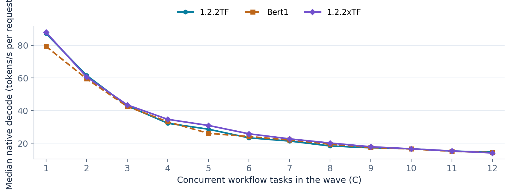
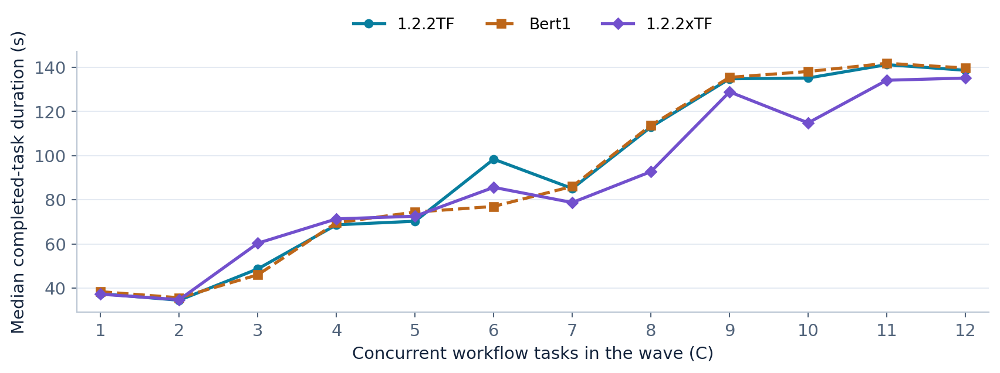
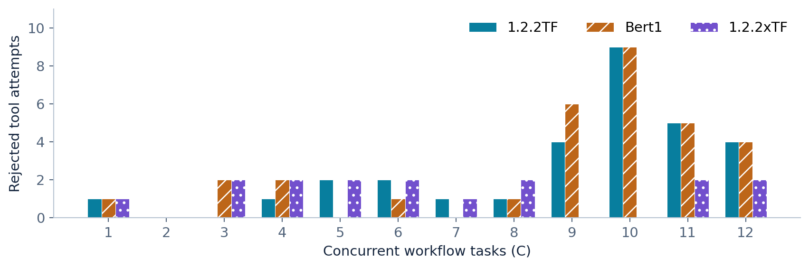
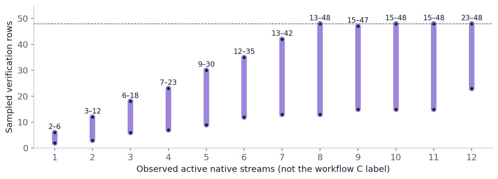

# TensorFold workflow benchmark: 1.2.2TF vs Bert1 vs 1.2.2xTF / 1.2.3

**Measured 20 October 2026.** This is the full Markdown companion to the
[34-page English PDF with exact model/quant/sampler addendum](../results/20261020-adaptive/workflow-report-reproducibility.pdf).
**1.2.3 is the release name for the configuration measured as 1.2.2xTF**;
the rename creates no new measurement. Evidence retains its original labels.

We measured 234 completed local agent tasks, 78 per recipe, with 1,031 model
requests. xTF had 8.76% less summed wave time than the original recipe and
16 intermediate rejected tool attempts instead of 30. These are results of
one matched-initial-input workflow pass, not proof of a general semantic
quality improvement or an isolated learner speedup.

## Navigation and evidence

- [Release configuration and installation](DS41F-1.2.3.md)
- [Exact model, quantization and sampling settings](BENCHMARK-SETTINGS-20261020.md)
- [Online cost/acceptance learner, equations and AdaSpark attribution](ADAPTIVE-SPECULATION.md)
- [All 36 comparison cells, full precision CSV](../results/20261020-adaptive/comparison-all-metrics.csv)
- [Native counter deltas](../results/20261020-adaptive/native-counters.csv)
- [234 per-task outcomes](../results/20261020-adaptive/task-results.csv)
- [1,031 per-request timings](../results/20261020-adaptive/request-timings.csv)
- [Aggregate JSON](../results/20261020-adaptive/measurement-summary.json)
- [Frozen source-evidence SHA-256 manifest](../results/20261020-adaptive/evidence-sha256.json)

Numeric exports contain no raw conversations, host addresses, credentials,
deployment configuration or images. The Markdown rounds presentation values;
the CSV files preserve the saved precision. Source digests identify private
frozen evidence without claiming that its conversations are public fixtures.

The report tables can be regenerated offline with
`python3 tools/render_adaptive_report.py --public .`; this reads only the
published numeric exports and performs no inference or network requests.

## Configurations and what changed

| Setting | Original 1.2.2TF | Bert1 | xTF, released as 1.2.3 |
|---|---:|---:|---:|
| Native serving slot cap | 12 | 16 | 12 |
| Shared verification rows, maximum | 32 | 48 | 48 |
| KV pool, tokens | 8,000,000 | 7,000,000 | 7,000,000 |
| Prompt-state snapshot cache | 2 GiB | 2 GiB | 3 GiB |
| Gateway reserved-token ceiling | 5,336,064 | 6,699,008 | 5,336,064 |
| Allocation | Original cost-based | Original cost-based | Online timing + acceptance calibration |

Original and Bert1 already allocated drafts dynamically from cost priors.
The new layer learns runtime corrections and acceptance calibration, with an
average-reward price for verification time. R includes mandatory anchor rows;
it is not a fixed per-stream speculation length. C in this campaign counts
parallel workflows. Actual native streams vary as those workflows use tools.

Held constant: DeepSeek V4.1 Flash 1017, frozen quantized weights and
tokenizer/template, Engram assets, TensorFold native CUDA stack, TP=3 on
three GB10 / Spark-class systems, 2,200 MHz GPU clock, existing graph,
prefetch, RDMA and target sampling paths. Vision remained C2/MEDIUM and
was not exercised by this campaign. Gateway admission ceilings are shown
for configuration transparency; the benchmark used the direct native API.

## Exact model, quantization and sampling

All three arms used **deepseek-ai/DeepSeek-V4.1-Flash-1017** at revision
`1bae0e1088993b9b82de08f59de5be5a34e42170`, with the same
**LakyFx/DeepSeek-V4.1-Flash-1017-EXL3-3.5bpw-TensorFold** weights at
`8621801c1fc74aece1fa83e67c6ade3fde1e7894`. Routed experts are approximately
**3.5101 bpw EXL3**; the model is mixed precision, with a K6 head, K4 DSpark
draft projections, FP8 Engram and BF16 vision. Runtime KV/index is FP4.

Effective sampling was **temperature 0.6, top_p 1.0, top_k 0 (disabled),
min_p 0.0, seed 42, thinking enabled / MAX**. The benchmark explicitly sent
temperature/seed/effort; top_p/top_k/min_p came from the checked native HTTP
defaults. No repetition/frequency/presence penalty overrides or custom stop
were requested. Each call allowed 65,536 output tokens; server context was
401,408 tokens. These are the measured settings, including temperature 0.6,
rather than the upstream recommendation of 1.0.

The [settings addendum](BENCHMARK-SETTINGS-20261020.md) includes pinned weight
links, tokenizer/template hashes, the exact request-control JSON and default
resolution evidence; [benchmark-settings.json](../results/20261020-adaptive/benchmark-settings.json)
is the machine-readable companion. The PDF adds the same information on pages
33–34, retaining the original 32 pages and all measurements.

## Workload and completion protocol

Each task repairs `merge_events`, executes isolated tests, performs paginated
usage accounting, and finishes with an explanation. Specifically:

1. Choose the newest timestamp per request ID, with later input winning ties;
   sort by request ID, do not mutate inputs, and return copies.
2. Run the actual isolated tests. The safe function evaluator forbids imports.
3. Query two pages of records, deduplicate IDs by latest time/later occurrence,
   retain backend `ds41` with status `done`, and total requests/prompt/output tokens.
4. Submit the correct accounting plus 4–6 Czech sentences, 30–180 words,
   explaining the fix, tests and accounting. This report is English; the
   tested task language was Czech.

The tools are `read_file`, `replace_file`, `run_tests`, `query_records` and
`finish_task`. Only `events.py` is available through `read_file`; attempts
to read hidden test files receive an error. The deterministic grader checks
code, executed tests, accounting and output format, not full prose semantics.

Each recipe ran C1 through C12: `1+2+...+12 = 78` workflows in 12 waves.
Initial request hashes match for every corresponding task across all 36
cells. Subsequent generated tokens, tool actions and prompts can diverge.
Sampling used temperature 0.6, seed 42 and MAX reasoning. Requests allowed
up to 65,536 tokens and the protocol had a 16-turn guard. Tasks ran to natural
completion; there was no arbitrary 120-second successful cutoff. A length
finish would not qualify as task success. Rejected tools and repair turns
remain in elapsed times and error counts.

The test used an owned tunnel to the native API with public ingress closed.
It measures local model/tool workflows, not whole Hermes sessions or public
gateway overhead. Bert1 was an already-running production process; original
TF and xTF used restarted native processes, so warmness was not identical.
There were no repeated trials, randomised profile ordering or confidence
intervals. Small-sample P95 values are descriptive observed quantiles.

## Aggregate results

| Metric | Original TF | Bert1 | xTF / 1.2.3 |
|---|---:|---:|---:|
| Completed / attempted tasks | 78 / 78 | 78 / 78 | 78 / 78 |
| Sum of measured wave times, s | 1347.872 | 1418.938 | 1229.795 |
| Task duration median / P95 / max, s | 117.047 / 170.937 / 190.313 | 118.055 / 182.516 / 239.515 | 108.726 / 154.031 / 159.453 |
| Model requests | 350 | 350 | 331 |
| Generated tokens, including reasoning | 164239 | 167522 | 153259 |
| All prompt tokens | 738845 | 749708 | 661718 |
| Actually computed prompt tokens | 124409 | 123864 | 122660 |
| Rejected intermediate tool attempts | 30 | 31 | 16 |
| Tasks with a rejection | 20 | 20 | 13 |
| Draft acceptance, % | 79.1331 | 77.5224 | 83.3199 |
| Pooled native decode median / P95 / max, tok/s | 20.778 / 65.019 / 107.882 | 20.733 / 61.952 / 98.356 | 20.979 / 71.660 / 108.649 |


The summed measured wave durations total **66:36.605** across all recipes.
That excludes switching, startup, waiting and an excluded partial attempt;
it is not one continuous campaign wall time. xTF's sum is 8.76% shorter than
TF and 13.33% shorter than Bert1. It generated 6.69% fewer tokens than TF
and used 331 rather than 350 model calls, so the full time reduction cannot
be attributed to native decode speed alone. Generated tokens include reasoning.

## Native decode and task duration




Median native per-request decode improved by **8.04% at C5, 10.63% at C6,
6.20% at C7 and 9.80% at C8** versus TF. At C12 it was **3.81% lower**.
These rates are not aggregate GPU throughput, and multiplying a request
median by workflow C is not a valid aggregate reconstruction.



The recipe did not reduce errors by simply slowing native decode at C6/C7:
the xTF native medians were faster there. Conversely, more TPS did not always
finish the task sooner:

| Counterexample | Original TF | Bert1 | xTF |
|---|---:|---:|---:|
| C3 median task duration, s | 48.69 | 46.00 | 60.31 |
| C6 median task duration, s | 98.38 | 76.97 | 85.62 |
| C12 median task duration, s | 138.68 | 139.70 | 135.16 |

At C3, xTF generated 8,286 tokens versus TF's 5,602, despite slightly faster
decode. At C6, xTF decoded faster than Bert1 but took longer to finish.
At C12, xTF finished sooner despite its lower native median rate.

## Prefill, first token and metric scope

The native timing table below pools requests. Milliseconds are shown for
latency, and tokens/s for the weighted uncached-prefill row.
| Native metric | Original TF | Bert1 | xTF / 1.2.3 |
|---|---:|---:|---:|
| Prefill median / P95 / max, ms | 235.488 / 864.063 / 1078.163 | 232.880 / 871.526 / 902.955 | 235.871 / 866.332 / 1068.424 |
| TTFT median / P95 / max, ms | 356.800 / 5990.956 / 10220.799 | 372.300 / 6033.545 / 10300.571 | 382.514 / 5993.822 / 10224.849 |
| Post-prefill upper bound median / P95 / max, ms | 4.142 / 7.173 / 8.966 | 3.910 / 7.326 / 15.999 | 3.720 / 7.118 / 8.900 |
| Weighted uncached prefill, tok/s | 847.642 | 841.002 | 860.986 |


**The xTF 3.72 ms post-prefill number is an upper bound, not its full TTFT.**
The frozen binary does not expose the exact post-prefill event interval.
The derived value removes scheduling wait and prefill but includes preparation
before submission:

```text
upper bound = native TTFT - native request seconds
              + (completion tokens - 1) / native decode TPS
```

The xTF received-to-first-token median was 382.51 ms. Exact post-prefill
latency remains null in the per-request export. Client first-delta latency
also includes client-to-server/delivery effects and may identify a reasoning
or tool delta, not the first visible prose answer token.

Native decode TPS describes the generation stage of one request. Weighted
native decode divides summed generated tokens by summed request decode times;
those times overlap under concurrency. Whole-wave TPS divides all generated
tokens by wave wall time, including prefill/tool/repair gaps. Weighted
uncached prefill uses actually computed prompt tokens over native prefill time,
excluding reused prefix tokens. These denominators are not interchangeable.

## Intermediate tool errors

Every recipe ultimately passed **78/78** tasks. These counts are intermediate
rejected attempts, not final task failures, HTTP crashes or native restarts.
| Exact tool error returned | Original TF | Bert1 | xTF / 1.2.3 |
|---|---:|---:|---:|
| unsupported pure-function syntax: Import | 10 | 8 | 7 |
| unsupported pure-function syntax: ImportFrom | 1 | 3 | 3 |
| one merge_events function required | 1 | 2 | 1 |
| unknown tool or invalid arguments | 11 | 10 | 2 |
| incorrect accounting: requests | 6 | 6 | 2 |
| provide a concise Czech explanation, 30 to180 words | 0 | 1 | 1 |
| provide four to six explanatory sentences | 1 | 1 | 0 |


The reduction from TF's 30 to xTF's 16 is **46.67% fewer counted rejections**;
Bert1's 31 to 16 is 48.39%. It is not a demonstrated reduction of the target
model's general reasoning error probability. Tool attempts were 508 / 508 /
487, and affected tasks were 20 / 20 / 13. Trajectories and denominators differ.

Most of the reduction came from unavailable test-file reads and incorrect
accounting. Import restrictions still caused ten xTF rejections.



| Rejection band | Original TF | Bert1 | xTF |
|---|---:|---:|---:|
| C1–C8 | 8 | 7 | 12 |
| C9–C10 | 13 | 15 | 0 |
| C11–C12 | 9 | 9 | 4 |

xTF had more errors in C1–C8, with its advantage concentrated later. One
pass does not establish that concurrency caused errors or that a particular
cache/allocator mechanism prevented them.

## Memory, KV and prompt snapshots
| Memory/cache observation | Original TF | Bert1 | xTF / 1.2.3 |
|---|---:|---:|---:|
| Minimum sampled MemAvailable, GiB | 7.227 | 4.091 | 6.190 |
| Maximum sampled full-memory PSI avg10, % | 0.00 | 0.05 | 0.00 |
| Native cancellations / preemptions | 0 / 0 | 0 / 0 | 0 / 0 |
| Prefix token reuse fraction, % | 83.1617 | 83.4784 | 81.4634 |


The Bert1 retained per-rank monitor files cover the continuation window;
TF/xTF monitoring covers their measured sweeps. The minima therefore are
descriptive, not a controlled full-run memory comparison. Cold historical
swap occupancy is not the same as current swap pressure. xTF sampled full
memory PSI remained zero; native cancellations and preemptions were zero
for all three recipes.

A larger prompt-state snapshot cache can reduce recomputation when retained
state is reused. Eviction does not show that the next supplied prompt lost
its text. xTF's prefix **token** reuse fraction was actually lower here:
81.46% versus 83.16% TF. This run does not establish a cache-driven speedup
or semantic quality gain. Prefix counters are token-denominated, not snapshot
object hit counts. The configured 7M/8M logical KV capacities were not filled
or stress-qualified by this workflow.

## Learner telemetry

The learner changes the shared row budget using online cost and conditional
acceptance feedback. Original TF/Bert already had cost-based allocation.
The [complete design](ADAPTIVE-SPECULATION.md) explains buckets, priors,
calibration, censored labels, average-reward pricing and fallbacks. No target
or draft weights were trained; the target verifier remains authoritative.

The idea was inspired by [AdaSpark, Liu et al.](https://arxiv.org/abs/2610.05774),
adapted to existing TensorFold chain/copy lanes. It is not a complete AdaSpark
or imparo replication. Our pinned/extrapolated priors, rolling median and
bucket calibration are implementation choices, not the paper's full method.
The paper's speedup figures are not our benchmark figures.
| Learner measurement | Value |
|---|---:|
| Rounds | 11672 |
| Cost updates | 11267 |
| Acceptance labels | 112076 |
| Probes | 2 |
| Rejected timing samples | 0 |
| Qualified prediction samples | 11267 |
| Normalised absolute timing error, % | 4.760549 |



| Active native streams | Sampled minimum rows | Sampled maximum rows |
|---|---:|---:|
| 1 | 2 | 6 |
| 2 | 3 | 12 |
| 3 | 6 | 18 |
| 4 | 7 | 23 |
| 5 | 9 | 30 |
| 6 | 12 | 35 |
| 7 | 13 | 42 |
| 8 | 13 | 48 |
| 9 | 15 | 47 |
| 10 | 15 | 48 |
| 11 | 15 | 48 |
| 12 | 23 | 48 |


Row ranges use 3-second telemetry samples, not every-round extrema. Native
stream count is not necessarily the C label of the enclosing workflow wave.
The timing error is `sum(abs(predicted - actual)) / sum(actual)`, not MAPE,
not a convergence curve and not “95.24% prediction accuracy”. Its mean
absolute error was 4.10 ms over 11,267 qualified samples and 969.52 s summed
measured verification time. The final sample had 1 stream / 6 rows / 4,023
context tokens; predicted/actual verify times were 46.659 / 47.453 ms.

The learner is shared across requests in one native process. A new chat does
not reset it; a process restart returns to priors. It does not persist to
disk or guarantee monotonic improvement. Rare probes are useful normal rounds,
not extra model benchmark calls.

## Interpretation and limitations

The strongest evidence is the recipe-level result: faster middle-load decode,
shorter summed workflow time, higher pooled draft acceptance and fewer repair
attempts in this pass. The changed row cap, KV budget, snapshot cache and
learner are not separate ablations. Different output volume and tool paths
also change wall time. Higher acceptance is an efficiency metric; the target
verifier does not grade the meaning of a tool command.

The frozen sampler keys randomness by seed, absolute position and token ID.
We have no basis to blame RNG-consumption order for trajectory differences.
GPU batch shapes can in general change floating-point results; see the
[PyTorch numerical accuracy background](https://docs.pytorch.org/docs/2.14/notes/numerical_accuracy.html).
No token-level numerical root-cause diagnosis was performed in this experiment.
General speculative-inference background is
[Leviathan et al. (2023)](https://proceedings.mlr.press/v202/leviathan23a.html).

This campaign does not validate long-session repetition resistance, semantic
quality on other tasks, full 7M/8M pool capacity, image throughput, mixed
text/vision contention, public-gateway latency or hours-long production
reliability. No such measurements are reconstructed from token-rate peaks.

## Run integrity and operational exceptions

An initial Bert1 C10 attempt was stopped by a cold swap-occupancy guard after
roughly 304 MiB of growth, without evidence of real memory pressure. Valid
C1–C9 cells were reused only after strict initial-input hash checks. C10–C12
were run in a shared fresh continuation namespace across all three recipes.
The retained partial attempt is excluded from the displayed cells, not
silently counted as a successful benchmark or a model-quality failure.

The first post-test API reopening did not complete, and the controller rolled
back automatically. A later promotion reopened and verified the selected
xTF API. Those are separate operational events, not the model/tool error
counts above. Switching/startup/deployment times are excluded from summed
wave durations. Pre-benchmark CPU-preparation receipts keep their historical
status labels; the later GPU workflow is the measurement reported here.

## Complete per-concurrency measurements

Each table below shows all C1–C12 cells in Original TF / Bert1 / xTF order.
TF means 1.2.2TF; xTF means the configuration now released as 1.2.3.
No fastest-repeat selection, synthetic missing cells or confidence intervals
are inserted. See the CSV supplements for full precision and individual tasks.

### A1 / Full workflow durations

Wave elapsed ends when the last task finishes; per-task distributions include tools and repairs.

| C | Wave elapsed, s / TF | Wave elapsed, s / Bert | Wave elapsed, s / xTF | Median task, s / TF | Median task, s / Bert | Median task, s / xTF | P95 task, s / TF | P95 task, s / Bert | P95 task, s / xTF |
|---|---:|---:|---:|---:|---:|---:|---:|---:|---:|
| 1 | 37.42 | 38.34 | 37.20 | 37.42 | 38.34 | 37.20 | 37.42 | 38.34 | 37.20 |
| 2 | 36.48 | 37.66 | 36.75 | 34.46 | 35.57 | 34.72 | 36.48 | 37.66 | 36.75 |
| 3 | 51.81 | 64.66 | 83.19 | 48.69 | 46.00 | 60.31 | 51.80 | 64.66 | 83.19 |
| 4 | 84.83 | 83.22 | 79.59 | 68.65 | 69.59 | 71.33 | 84.81 | 83.22 | 79.59 |
| 5 | 86.28 | 81.72 | 95.75 | 70.27 | 74.41 | 72.53 | 86.28 | 81.72 | 95.75 |
| 6 | 115.14 | 96.33 | 120.53 | 98.38 | 76.97 | 85.62 | 115.12 | 96.31 | 120.53 |
| 7 | 99.05 | 87.66 | 91.34 | 85.09 | 86.05 | 78.73 | 99.05 | 87.66 | 91.34 |
| 8 | 127.38 | 132.11 | 107.88 | 112.97 | 113.73 | 92.74 | 127.38 | 132.09 | 107.88 |
| 9 | 167.58 | 182.52 | 139.14 | 134.81 | 135.47 | 128.89 | 167.58 | 182.52 | 139.12 |
| 10 | 183.73 | 239.52 | 124.92 | 135.18 | 138.12 | 114.84 | 183.73 | 239.52 | 124.92 |
| 11 | 167.83 | 173.64 | 154.03 | 141.23 | 141.84 | 134.16 | 167.81 | 173.64 | 154.03 |
| 12 | 190.34 | 201.58 | 159.47 | 138.68 | 139.70 | 135.16 | 190.31 | 201.56 | 159.45 |


### A2 / Native decode distributions

These are native per-request rates, not aggregate GPU throughput. Weighted time is a sum of overlapping request decode times.

| C | Median, tok/s / TF | Median, tok/s / Bert | Median, tok/s / xTF | P95, tok/s / TF | P95, tok/s / Bert | P95, tok/s / xTF | Weighted, tok/s / TF | Weighted, tok/s / Bert | Weighted, tok/s / xTF |
|---|---:|---:|---:|---:|---:|---:|---:|---:|---:|
| 1 | 87.28 | 79.35 | 88.00 | 107.88 | 98.36 | 108.65 | 84.37 | 82.36 | 84.95 |
| 2 | 61.59 | 59.51 | 60.68 | 80.34 | 67.92 | 82.44 | 56.66 | 55.13 | 56.37 |
| 3 | 43.02 | 42.58 | 43.53 | 67.75 | 89.28 | 85.91 | 42.63 | 44.91 | 46.65 |
| 4 | 32.27 | 33.16 | 34.66 | 79.80 | 57.85 | 92.68 | 32.93 | 32.92 | 34.47 |
| 5 | 28.63 | 26.11 | 30.93 | 72.31 | 33.17 | 99.01 | 27.67 | 26.82 | 30.63 |
| 6 | 23.34 | 24.12 | 25.82 | 38.60 | 53.83 | 63.17 | 23.61 | 25.37 | 26.23 |
| 7 | 21.38 | 22.03 | 22.70 | 35.42 | 31.25 | 36.90 | 21.66 | 20.65 | 22.80 |
| 8 | 18.36 | 19.44 | 20.15 | 38.78 | 34.67 | 35.40 | 19.53 | 19.93 | 19.82 |
| 9 | 17.24 | 17.41 | 17.87 | 48.18 | 48.09 | 34.01 | 18.63 | 18.91 | 17.62 |
| 10 | 16.66 | 16.52 | 16.62 | 76.11 | 73.60 | 27.30 | 18.14 | 19.79 | 16.50 |
| 11 | 15.20 | 15.11 | 15.31 | 31.87 | 29.38 | 31.59 | 15.15 | 15.10 | 15.76 |
| 12 | 14.65 | 14.36 | 14.09 | 49.81 | 53.49 | 26.91 | 15.26 | 15.21 | 14.31 |


### A3 / Full request and wave rates

Request wall includes queue/prefill/delivery; whole-wave includes tools and repairs. Reasoning is included.

| C | Request median, tok/s / TF | Request median, tok/s / Bert | Request median, tok/s / xTF | Whole-wave, tok/s / TF | Whole-wave, tok/s / Bert | Whole-wave, tok/s / xTF | Correct tasks/min / TF | Correct tasks/min / Bert | Correct tasks/min / xTF |
|---|---:|---:|---:|---:|---:|---:|---:|---:|---:|
| 1 | 75.80 | 73.28 | 77.92 | 78.99 | 77.09 | 79.46 | 1.60 | 1.56 | 1.61 |
| 2 | 46.17 | 41.80 | 47.26 | 98.73 | 95.66 | 98.01 | 3.29 | 3.19 | 3.27 |
| 3 | 38.31 | 38.43 | 37.81 | 108.12 | 96.70 | 99.61 | 3.47 | 2.78 | 2.16 |
| 4 | 30.88 | 28.99 | 32.70 | 105.41 | 103.95 | 112.84 | 2.83 | 2.88 | 3.02 |
| 5 | 24.52 | 24.57 | 26.49 | 111.46 | 113.41 | 112.68 | 3.48 | 3.67 | 3.13 |
| 6 | 21.87 | 21.30 | 22.12 | 114.65 | 114.93 | 114.26 | 3.13 | 3.74 | 2.99 |
| 7 | 20.08 | 19.45 | 20.12 | 120.81 | 125.21 | 125.52 | 4.24 | 4.79 | 4.60 |
| 8 | 17.90 | 17.45 | 17.91 | 124.41 | 121.68 | 128.11 | 3.77 | 3.63 | 4.45 |
| 9 | 16.66 | 16.60 | 17.05 | 128.10 | 125.17 | 136.37 | 3.22 | 2.96 | 3.88 |
| 10 | 16.42 | 15.81 | 15.28 | 127.90 | 113.39 | 137.39 | 3.27 | 2.51 | 4.80 |
| 11 | 14.94 | 13.80 | 14.72 | 135.22 | 132.34 | 137.67 | 3.93 | 3.80 | 4.28 |
| 12 | 14.11 | 14.01 | 13.50 | 130.53 | 127.43 | 139.49 | 3.78 | 3.57 | 4.52 |


### A4 / Prefill timing and weighted speed

Speed uses actually computed input, excluding prefix reuse. These short-request rates are not long uncached-prompt microbenchmarks.

| C | Median, ms / TF | Median, ms / Bert | Median, ms / xTF | P95, ms / TF | P95, ms / Bert | P95, ms / xTF | Weighted, tok/s / TF | Weighted, tok/s / Bert | Weighted, tok/s / xTF |
|---|---:|---:|---:|---:|---:|---:|---:|---:|---:|
| 1 | 230.42 | 264.36 | 237.73 | 1,078.16 | 867.88 | 1,068.42 | 748.38 | 728.79 | 747.46 |
| 2 | 369.83 | 399.80 | 371.43 | 844.15 | 847.41 | 836.99 | 885.56 | 840.25 | 885.89 |
| 3 | 368.76 | 233.20 | 220.43 | 863.25 | 871.55 | 856.65 | 886.54 | 799.14 | 855.62 |
| 4 | 329.40 | 223.85 | 225.96 | 866.09 | 882.48 | 884.30 | 844.66 | 820.54 | 829.83 |
| 5 | 395.10 | 380.76 | 229.09 | 854.03 | 868.16 | 860.01 | 816.72 | 867.91 | 848.93 |
| 6 | 245.32 | 233.62 | 232.53 | 860.59 | 868.24 | 857.52 | 837.44 | 867.14 | 860.52 |
| 7 | 222.71 | 383.62 | 235.87 | 863.33 | 868.04 | 867.44 | 870.41 | 869.22 | 868.54 |
| 8 | 242.82 | 248.42 | 225.87 | 875.12 | 864.03 | 860.63 | 863.01 | 864.70 | 863.53 |
| 9 | 221.70 | 222.80 | 495.08 | 858.54 | 873.23 | 884.32 | 851.59 | 836.00 | 863.95 |
| 10 | 225.56 | 228.14 | 382.46 | 869.81 | 874.43 | 854.61 | 832.67 | 817.98 | 876.50 |
| 11 | 239.42 | 231.53 | 234.69 | 868.87 | 871.53 | 868.04 | 837.34 | 836.53 | 861.64 |
| 12 | 222.89 | 228.02 | 239.33 | 863.11 | 874.83 | 865.19 | 859.95 | 844.68 | 864.67 |


### A5 / Computed prefill work

Per-request quantiles and total-token / total-time weighted rates use different weighting.

| C | Median, tok/s / TF | Median, tok/s / Bert | Median, tok/s / xTF | P95, tok/s / TF | P95, tok/s / Bert | P95, tok/s / xTF | Computed tokens / TF | Computed tokens / Bert | Computed tokens / xTF |
|---|---:|---:|---:|---:|---:|---:|---:|---:|---:|
| 1 | 347.19 | 302.62 | 336.52 | 953.47 | 1,184.50 | 962.16 | 1,601 | 1,601 | 1,601 |
| 2 | 561.04 | 507.30 | 552.22 | 1,244.41 | 1,213.11 | 1,230.37 | 3,129 | 3,129 | 3,129 |
| 3 | 551.77 | 338.59 | 351.96 | 1,234.73 | 1,211.55 | 1,232.72 | 4,674 | 4,917 | 4,718 |
| 4 | 416.38 | 345.41 | 354.05 | 1,215.79 | 1,199.27 | 1,217.49 | 6,471 | 6,450 | 6,527 |
| 5 | 440.39 | 544.00 | 338.90 | 1,228.88 | 1,199.05 | 1,222.96 | 8,461 | 7,788 | 8,077 |
| 6 | 333.02 | 347.64 | 352.93 | 1,201.95 | 1,206.67 | 1,203.97 | 9,606 | 9,351 | 9,406 |
| 7 | 329.70 | 535.58 | 338.91 | 1,200.90 | 1,190.32 | 1,202.04 | 10,896 | 10,875 | 10,924 |
| 8 | 340.06 | 353.42 | 337.02 | 1,217.48 | 1,233.34 | 1,218.27 | 12,466 | 12,471 | 12,474 |
| 9 | 348.66 | 336.11 | 634.24 | 1,203.32 | 1,208.36 | 1,231.67 | 14,381 | 14,454 | 14,305 |
| 10 | 345.11 | 334.27 | 546.25 | 1,212.20 | 1,204.16 | 1,221.64 | 16,005 | 15,990 | 15,602 |
| 11 | 349.00 | 355.85 | 348.09 | 1,221.17 | 1,213.94 | 1,212.74 | 17,958 | 17,955 | 17,190 |
| 12 | 338.69 | 335.27 | 343.75 | 1,217.83 | 1,213.93 | 1,215.57 | 18,761 | 18,883 | 18,707 |


### A6 / Native TTFT and client first delta

Client delta may be reasoning or a tool delta. Native TTFT begins at request receipt.

| C | Native median, ms / TF | Native median, ms / Bert | Native median, ms / xTF | Native P95, ms / TF | Native P95, ms / Bert | Native P95, ms / xTF | Client median, ms / TF | Client median, ms / Bert | Client median, ms / xTF |
|---|---:|---:|---:|---:|---:|---:|---:|---:|---:|
| 1 | 234.80 | 268.74 | 245.31 | 1,079.86 | 870.49 | 1,070.80 | 500.00 | 610.00 | 453.00 |
| 2 | 396.91 | 499.71 | 388.27 | 1,652.86 | 1,695.80 | 1,673.81 | 546.50 | 703.50 | 563.00 |
| 3 | 402.15 | 249.26 | 244.43 | 2,518.59 | 2,544.45 | 2,519.91 | 656.00 | 500.00 | 312.50 |
| 4 | 387.67 | 284.01 | 295.75 | 3,404.66 | 3,464.71 | 3,439.90 | 570.50 | 515.00 | 562.00 |
| 5 | 438.44 | 453.39 | 287.80 | 3,382.66 | 3,434.83 | 3,394.81 | 875.00 | 969.00 | 718.00 |
| 6 | 373.59 | 315.15 | 347.17 | 4,255.23 | 4,285.41 | 4,235.11 | 656.00 | 703.00 | 632.50 |
| 7 | 350.29 | 450.54 | 363.90 | 5,135.78 | 5,170.13 | 5,133.20 | 641.00 | 1,047.00 | 1,047.00 |
| 8 | 459.28 | 380.54 | 317.62 | 5,990.96 | 5,964.90 | 5,953.24 | 672.00 | 875.00 | 601.50 |
| 9 | 323.94 | 374.75 | 589.68 | 5,973.60 | 6,038.59 | 6,840.73 | 672.00 | 797.00 | 734.00 |
| 10 | 351.85 | 343.82 | 538.84 | 6,874.47 | 6,851.47 | 6,759.24 | 578.00 | 594.00 | 1,148.00 |
| 11 | 354.48 | 429.83 | 372.74 | 7,674.90 | 7,732.63 | 7,681.16 | 688.00 | 765.00 | 1,163.50 |
| 12 | 395.65 | 378.61 | 402.82 | 8,479.62 | 8,572.12 | 8,506.17 | 1,195.00 | 999.50 | 1,258.00 |


### A7 / Post-prefill bound and acceptance

Bound is not exact post-prefill latency; acceptance is draft/target agreement, not task correctness.

| C | Bound median, ms / TF | Bound median, ms / Bert | Bound median, ms / xTF | Bound P95, ms / TF | Bound P95, ms / Bert | Bound P95, ms / xTF | Acceptance, % / TF | Acceptance, % / Bert | Acceptance, % / xTF |
|---|---:|---:|---:|---:|---:|---:|---:|---:|---:|
| 1 | 3.515 | 3.874 | 6.039 | 4.612 | 7.540 | 7.410 | 71.44 | 71.41 | 75.73 |
| 2 | 4.768 | 4.979 | 3.588 | 6.518 | 6.943 | 6.777 | 77.10 | 77.27 | 79.77 |
| 3 | 3.751 | 3.950 | 4.025 | 7.298 | 8.372 | 6.529 | 76.37 | 75.35 | 77.34 |
| 4 | 4.052 | 4.300 | 3.671 | 6.609 | 7.699 | 8.286 | 73.07 | 73.57 | 81.52 |
| 5 | 5.309 | 3.813 | 4.169 | 7.173 | 5.590 | 8.062 | 77.68 | 77.24 | 82.32 |
| 6 | 5.181 | 3.748 | 4.144 | 6.860 | 6.913 | 6.254 | 75.40 | 78.58 | 80.21 |
| 7 | 3.632 | 3.957 | 3.664 | 5.616 | 5.705 | 6.854 | 79.05 | 80.39 | 85.12 |
| 8 | 4.014 | 3.637 | 3.660 | 7.534 | 6.027 | 6.213 | 78.34 | 78.03 | 83.66 |
| 9 | 3.840 | 4.070 | 3.396 | 7.088 | 8.261 | 7.219 | 78.92 | 77.05 | 84.67 |
| 10 | 4.761 | 3.892 | 3.328 | 7.630 | 7.758 | 6.374 | 80.55 | 76.19 | 86.26 |
| 11 | 3.863 | 4.401 | 4.076 | 8.497 | 7.327 | 7.983 | 83.65 | 80.16 | 85.66 |
| 12 | 4.149 | 3.834 | 3.847 | 6.672 | 7.775 | 6.700 | 82.38 | 78.06 | 84.24 |


### A8 / Requests, output and errors

Same initial inputs; later trajectories and output volumes differ.

| C | Requests / TF | Requests / Bert | Requests / xTF | Generated tokens / TF | Generated tokens / Bert | Generated tokens / xTF | Rejected tools / TF | Rejected tools / Bert | Rejected tools / xTF |
|---|---:|---:|---:|---:|---:|---:|---:|---:|---:|
| 1 | 5 | 5 | 5 | 2,956 | 2,956 | 2,956 | 1 | 1 | 1 |
| 2 | 8 | 8 | 8 | 3,602 | 3,602 | 3,602 | 0 | 0 | 0 |
| 3 | 12 | 15 | 14 | 5,602 | 6,252 | 8,286 | 0 | 2 | 2 |
| 4 | 18 | 19 | 19 | 8,942 | 8,651 | 8,981 | 1 | 2 | 2 |
| 5 | 25 | 20 | 23 | 9,617 | 9,268 | 10,789 | 2 | 0 | 2 |
| 6 | 27 | 25 | 26 | 13,201 | 11,071 | 13,772 | 2 | 1 | 2 |
| 7 | 29 | 28 | 29 | 11,966 | 10,975 | 11,465 | 1 | 0 | 1 |
| 8 | 33 | 33 | 34 | 15,847 | 16,075 | 13,820 | 1 | 1 | 2 |
| 9 | 41 | 43 | 37 | 21,467 | 22,845 | 18,975 | 4 | 6 | 0 |
| 10 | 49 | 49 | 40 | 23,500 | 27,159 | 17,163 | 9 | 9 | 0 |
| 11 | 51 | 51 | 46 | 22,694 | 22,980 | 21,206 | 5 | 5 | 2 |
| 12 | 52 | 54 | 50 | 24,845 | 25,688 | 22,244 | 4 | 4 | 2 |


### A9 / Native drafts and request rounds

The request-round sum is not a count of unique shared GPU rounds.

| C | Drafted / TF | Drafted / Bert | Drafted / xTF | Accepted / TF | Accepted / Bert | Accepted / xTF | Request-round sum / TF | Request-round sum / Bert | Request-round sum / xTF |
|---|---:|---:|---:|---:|---:|---:|---:|---:|---:|
| 1 | 2,941 | 2,942 | 2,732 | 2,101 | 2,101 | 2,069 | 854 | 854 | 886 |
| 2 | 3,297 | 3,295 | 3,105 | 2,542 | 2,546 | 2,477 | 1,057 | 1,053 | 1,122 |
| 3 | 5,158 | 5,796 | 7,137 | 3,939 | 4,367 | 5,520 | 1,660 | 1,881 | 2,763 |
| 4 | 8,271 | 8,010 | 7,360 | 6,044 | 5,893 | 6,000 | 2,892 | 2,752 | 2,974 |
| 5 | 8,585 | 8,257 | 8,745 | 6,669 | 6,378 | 7,199 | 2,941 | 2,882 | 3,581 |
| 6 | 11,794 | 9,780 | 10,897 | 8,893 | 7,685 | 8,740 | 4,300 | 3,379 | 5,025 |
| 7 | 10,349 | 9,409 | 9,111 | 8,181 | 7,564 | 7,755 | 3,776 | 3,401 | 3,701 |
| 8 | 13,562 | 13,992 | 10,602 | 10,624 | 10,918 | 8,870 | 5,214 | 5,148 | 4,938 |
| 9 | 18,029 | 19,980 | 14,575 | 14,229 | 15,394 | 12,340 | 7,222 | 7,436 | 6,617 |
| 10 | 19,234 | 23,932 | 12,758 | 15,493 | 18,234 | 11,005 | 7,988 | 8,911 | 6,140 |
| 11 | 17,200 | 19,220 | 16,187 | 14,388 | 15,406 | 13,865 | 8,290 | 7,561 | 7,324 |
| 12 | 18,663 | 21,826 | 16,766 | 15,375 | 17,037 | 14,123 | 9,451 | 8,636 | 8,106 |


### A10 / Prefix counters and output per request-round

Prefix queries/hits count tokens, not snapshot objects. Output/req-round is not shared-round device throughput.

| C | Token queries / TF | Token queries / Bert | Token queries / xTF | Token hits / TF | Token hits / Bert | Token hits / xTF | Output/req-round / TF | Output/req-round / Bert | Output/req-round / xTF |
|---|---:|---:|---:|---:|---:|---:|---:|---:|---:|
| 1 | 12,985 | 12,985 | 12,985 | 11,384 | 11,384 | 11,384 | 3.461 | 3.461 | 3.336 |
| 2 | 16,169 | 16,169 | 16,169 | 13,040 | 13,040 | 13,040 | 3.408 | 3.421 | 3.210 |
| 3 | 23,062 | 35,955 | 32,326 | 18,388 | 31,038 | 27,608 | 3.375 | 3.324 | 2.999 |
| 4 | 38,731 | 41,856 | 40,973 | 32,260 | 35,406 | 34,446 | 3.092 | 3.144 | 3.020 |
| 5 | 55,687 | 37,518 | 52,071 | 47,226 | 29,730 | 43,994 | 3.270 | 3.216 | 3.013 |
| 6 | 56,678 | 48,671 | 52,674 | 47,072 | 39,320 | 43,268 | 3.070 | 3.276 | 2.741 |
| 7 | 52,618 | 49,791 | 53,676 | 41,722 | 38,916 | 42,752 | 3.169 | 3.227 | 3.098 |
| 8 | 63,626 | 63,575 | 65,018 | 51,160 | 51,104 | 52,544 | 3.039 | 3.123 | 2.799 |
| 9 | 89,999 | 100,258 | 73,675 | 75,618 | 85,804 | 59,370 | 2.972 | 3.072 | 2.868 |
| 10 | 111,157 | 119,336 | 74,304 | 95,152 | 103,346 | 58,702 | 2.942 | 3.048 | 2.795 |
| 11 | 111,714 | 111,295 | 91,030 | 93,756 | 93,340 | 73,840 | 2.738 | 3.039 | 2.895 |
| 12 | 106,419 | 112,299 | 96,817 | 87,658 | 93,416 | 78,110 | 2.629 | 2.975 | 2.744 |


### A11 / Native summed time and reuse

Overlapping request times can exceed wave wall time. Prefix reuse equals token hits / token queries.

| C | Prefill seconds / TF | Prefill seconds / Bert | Prefill seconds / xTF | Decode seconds / TF | Decode seconds / Bert | Decode seconds / xTF | Prefix reuse, % / TF | Prefix reuse, % / Bert | Prefix reuse, % / xTF |
|---|---:|---:|---:|---:|---:|---:|---:|---:|---:|
| 1 | 2.139 | 2.197 | 2.142 | 35.03 | 35.89 | 34.80 | 87.67 | 87.67 | 87.67 |
| 2 | 3.533 | 3.724 | 3.532 | 63.58 | 65.34 | 63.90 | 80.65 | 80.65 | 80.65 |
| 3 | 5.272 | 6.153 | 5.514 | 131.42 | 139.21 | 177.63 | 79.73 | 86.32 | 85.40 |
| 4 | 7.661 | 7.861 | 7.865 | 271.52 | 262.77 | 260.58 | 83.29 | 84.59 | 84.07 |
| 5 | 10.360 | 8.973 | 9.514 | 347.60 | 345.56 | 352.21 | 84.81 | 79.24 | 84.49 |
| 6 | 11.471 | 10.784 | 10.931 | 559.18 | 436.36 | 525.08 | 83.05 | 80.79 | 82.14 |
| 7 | 12.518 | 12.511 | 12.577 | 552.41 | 531.39 | 502.91 | 79.29 | 78.16 | 79.65 |
| 8 | 14.445 | 14.422 | 14.445 | 811.52 | 806.64 | 697.44 | 80.41 | 80.38 | 80.81 |
| 9 | 16.887 | 17.290 | 16.558 | 1,152.55 | 1,208.10 | 1,076.89 | 84.02 | 85.58 | 80.58 |
| 10 | 19.221 | 19.548 | 17.800 | 1,295.45 | 1,372.24 | 1,040.32 | 85.60 | 86.60 | 79.00 |
| 11 | 21.446 | 21.464 | 19.950 | 1,498.39 | 1,521.84 | 1,345.48 | 83.93 | 83.87 | 81.12 |
| 12 | 21.816 | 22.355 | 21.635 | 1,627.88 | 1,688.44 | 1,554.69 | 82.37 | 83.19 | 80.68 |


## Coverage, integrity and how to use these numbers

All 36 cells had `correct = total = C`; `runtime_coverage_requests = requests`,
`coverage=True` and `failures_retained=True`. The full-precision CSV retains
these fields and `rate_scope`. Native generated/computed-token and request
counts agree with the matching comparison cells. There were no native
cancellations or preemptions. Printed numeric tables in the PDF were checked
independently against 1,188 source values; the Markdown tables are generated
from those same numeric exports. A release test verifies them against CSV.

The reusable lesson is to compare task duration, output volume, repair
categories and latency definitions beside TPS. xTF was the strongest overall
recipe in this pass, but it did not win every cell and this single pass does
not establish a general model-quality gain. Historical benchmark campaigns
elsewhere in the repository retain their own models, scopes and metric
definitions; do not blend them into this matched-input comparison.
